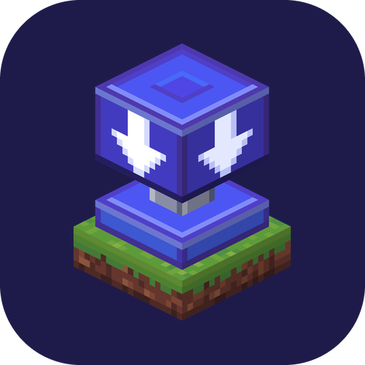
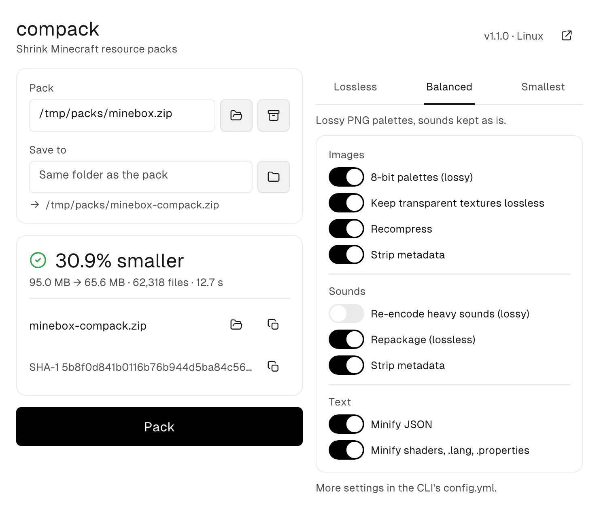

<p align="center"></p>

<h1 align="center">compack</h1>

Shrinks Minecraft: Java Edition resource and data packs into one ZIP. A
single-binary alternative to [PackSquash](https://github.com/ComunidadAylas/PackSquash)
that never rejects a file: overlays, extra files and unusual layouts are kept.

| [Minebox](https://minebox.co/) resource pack | Size | Time |
| --- | --- | --- |
| Original | 95.0 MB | |
| PackSquash | 68.4 MB | 124 s |
| compack | 65.6 MB | 13 s |

## Install

Download a binary from [Releases](https://github.com/qore-games/compack/releases)
(Linux, macOS, Windows), or:

```sh
go install github.com/qore-games/compack@latest
```

The tools compack runs (oxipng, OptiVorbis, pngquant, oggshrink) are embedded
in the binary. Linux arm64 has no pngquant build, so PNGs stay lossless there.

## Usage

```sh
compack ./my-pack -out pack.zip          # a pack folder
compack ./my-pack.zip -out pack.zip      # or a .zip
compack -skip-png-quant ./my-pack        # lossless PNGs only
compack -config compack.yml ./my-pack    # settings from a file
```

It ends with the output's size and SHA-1, the hash `resource-pack-sha1` in
`server.properties` expects. The same input and settings always give the same
bytes.

Every flag and `config.yml` key, the `-events` JSON output, `-cache` and the
ZIP format: [docs/configuration.md](docs/configuration.md).

## What it does

| Files | |
| --- | --- |
| `.png` | 8-bit palette with pngquant (lossy, skipped for textures using their alpha channel), then oxipng |
| `.ogg` | OptiVorbis: same audio, smaller container, metadata removed. `-ogg-lossy` re-encodes first (−8% on Minebox, opt-in) |
| `.json` `.mcmeta` | minified, comments removed |
| `.vsh` `.fsh` `.glsl` `.lang` `.properties` | comments and blank lines removed |
| everything else | kept as is |

Identical files share one entry, and the ZIP keeps only what Minecraft reads.
7-Zip cannot open the result unless you pass `-zip-local-names`.

## Desktop app

<p align="center"></p>

Pick a pack, choose Lossless, Balanced or Smallest (or set each option), press
**Pack**: the window shows the progress, then the size saved and the SHA-1.
Paths and options are remembered. Download it from
[Releases](https://github.com/qore-games/compack/releases); on Linux the file
dialogs need `zenity` or `kdialog` (or paste the paths).

Also available online: [mineassets.com/tools/compack](https://mineassets.com/tools/compack).

## Build

```sh
go build -o compack .            # the CLI
go test ./...

cd app                           # the desktop app (Native SDK)
./dev.sh                         # run it, markup hot reload
./build.sh build                 # release build in zig-out/bin/
node --test test/core.test.mjs   # core tests
```

Changes: [CHANGELOG.md](CHANGELOG.md). Issues and pull requests are welcome,
new optimizers especially.
